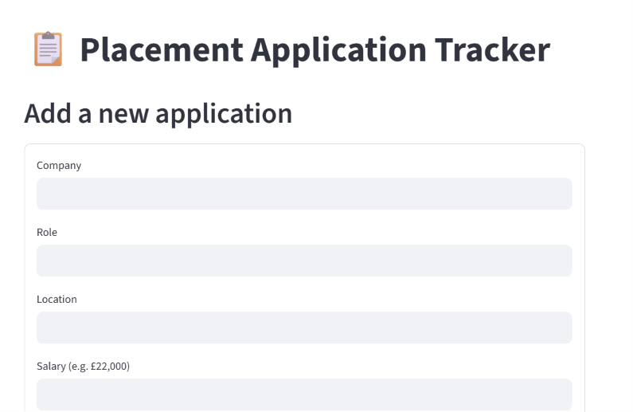

#  Placement Application Tracker

A web app built with Python and Streamlit to track university placement applications — company, role, location, salary, status, and notes — with a live dashboard showing application progress.

## Features

- Add new applications through a form (company, role, location, salary, date applied, status, notes)
- Colour-coded bar chart showing applications by status (Applied, Interview, Offer, Rejected)
- Filter applications by status
- Update an application's status or notes without re-entering it
- Delete applications
- Data stored locally in a SQLite database

## Built with

- **Python**
- **Streamlit** — web interface
- **SQLite** — local database
- **pandas** — data handling
- **Altair** — charting

## How to run it locally

1. Clone this repository:
   git clone https://github.com/mishma9809/placement-tracker.git
   cd placement-tracker

2. Create and activate a virtual environment:
python -m venv venv
venv\Scripts\activate # Windows
source venv/bin/activate # Mac/Linux

3. Install the dependencies:
pip install -r requirements.txt

4. Run the app:
streamlit run app.py

5. Open `http://localhost:8501` in your browser.

## Screenshot

Built as a SECOND-year CS student to practise working with databases, data handling, and building a usable interface end to end — while also solving a real problem (tracking my own placement applications).